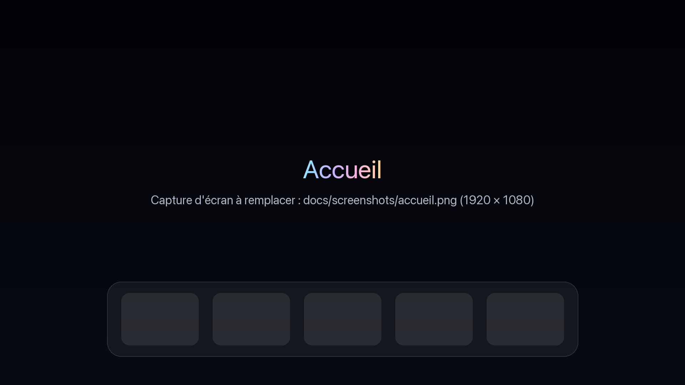
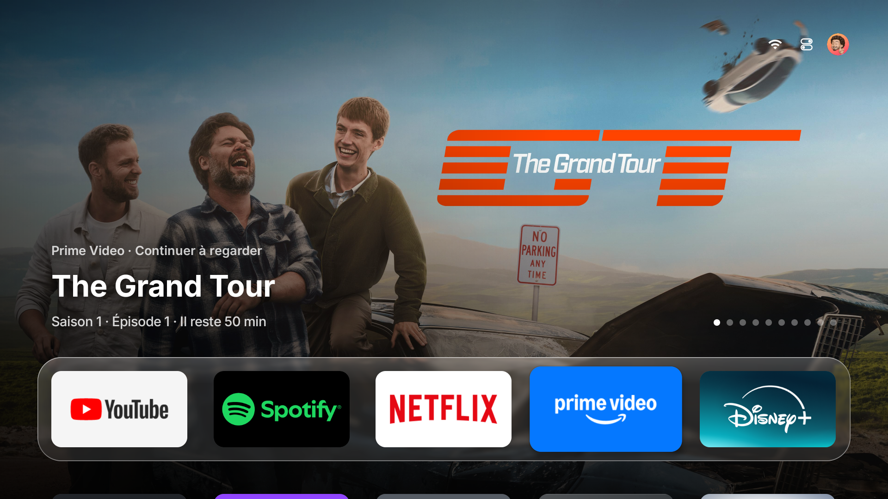
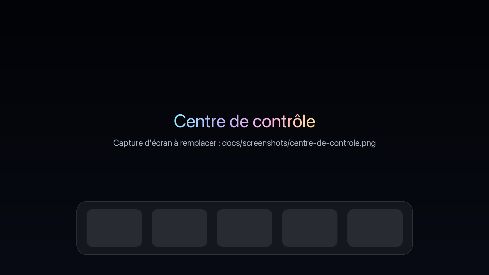
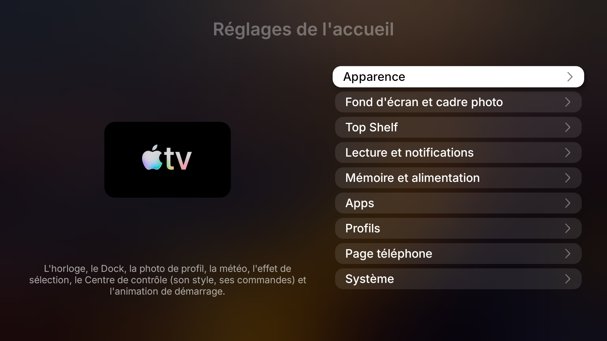
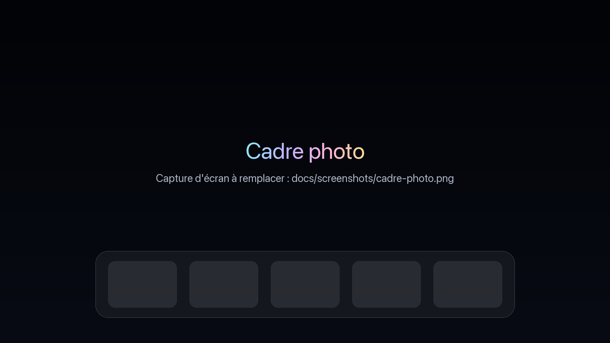
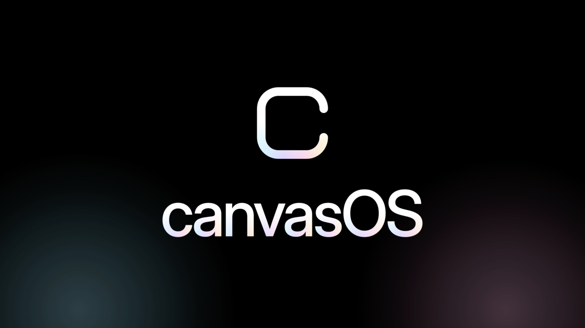

<p align="center">
  
</p>

<p align="center"><strong>L'écran d'accueil de l'Apple TV, sur votre box ou votre téléviseur Android.</strong></p>

<p align="center">Lanceur Android TV · Android 9 ou plus · sans root · installé depuis votre ordinateur par un agent IA</p>

<p align="center">
  <a href="https://canvasos.pages.dev">Site</a> ·
  <a href="https://github.com/getisolated/canvasOS/releases/latest">Dernière version</a> ·
  <a href="#installation-par-un-agent-ia">Installation</a> ·
  <a href="AGENTS.md">Guide suivi par l'agent</a>
</p>

<!-- CAPTURE D'ÉCRAN PRINCIPALE : remplacez docs/screenshots/accueil.png par une capture de l'accueil (1920 × 1080, PNG ou JPG). -->
<p align="center">
  
</p>

## canvasOS en deux mots

canvasOS remplace l'écran d'accueil d'Android TV, de Google TV ou d'une box Android par une interface calquée sur **tvOS**, le système de l'Apple TV. Un Dock en verre liquide posé sur une grande photo. Un **Top Shelf** où l'app sélectionnée affiche ses contenus. Un **Centre de contrôle** en verre dépoli, ouvert par la touche Retour. Des réglages présentés comme ceux de l'Apple TV. Un cadre photo et les vues aériennes de l'Apple TV en économiseur d'écran. Et une animation de démarrage dont le logo final s'agrandit et s'ouvre sur l'accueil.

Tout le reste du téléviseur est conservé : vos apps, vos entrées HDMI, les réglages du fabricant. canvasOS est un lanceur, pas un firmware. Il s'installe comme une app, prend la place de l'écran d'accueil, et se désinstalle de la même façon. L'interface est en français.

canvasOS est un projet indépendant et open source. Il n'est ni affilié à Apple, ni approuvé par Apple.

## Captures d'écran

<!--
EMPLACEMENTS POUR VOS CAPTURES
Chaque image ci-dessous est un visuel provisoire. Pour le remplacer, enregistrez votre capture
sous le même nom dans docs/screenshots/ (1920 × 1080, PNG ou JPG, en changeant l'extension ici si besoin) :
  adb -s <IP_TV>:5555 exec-out screencap -p > docs/screenshots/accueil.png
Fichiers attendus : accueil.png, top-shelf.png, centre-de-controle.png, reglages.png, cadre-photo.png, animation.png
-->

| Top Shelf | Centre de contrôle |
|---|---|
|  |  |
| **Réglages de l'accueil** | **Cadre photo** |
|  |  |

<!-- CAPTURE : l'animation de démarrage, au moment où le logo s'ouvre sur l'accueil. -->
<p align="center">
  
</p>

## Ce que fait canvasOS

- **Accueil.** Des tuiles 16:9 aux coins arrondis sur un Dock en verre ; la tuile sélectionnée grossit, s'incline et reflète la lumière comme sur tvOS. Des dossiers, comme sur l'Apple TV. L'app ouverte passe en tête du Dock (ou pas, au choix). Les entrées HDMI s'épinglent sur l'accueil. Une petite horloge, la météo et la photo de profil en haut à droite.
- **Profils.** Chaque profil a son accueil : ordre des apps, apps masquées, dossiers, fond d'écran. Un profil enfant demande un code PIN pour changer de profil, ouvrir les réglages ou supprimer une app.
- **Top Shelf.** Quand une app du Dock est sélectionnée, l'écran se remplit de ses contenus : la ligne « Continuer à regarder » qu'elle publie pour Android TV (YouTube, Netflix, Prime Video…), ou les titres populaires de la semaine sur ce service d'après TMDB.
- **Centre de contrôle.** Touche Retour sur l'accueil : Éteindre, Veille (avec minuteur), Réseau, Libérer la mémoire, Photo suivante, Cadre photo, Réglages, le lecteur de ce qui est en cours de lecture (pochette, titre, progression), Luminosité, Source, Météo sur cinq jours, Bluetooth. La grille se réorganise sur le téléviseur, comme sur tvOS.
- **Fond d'écran et cadre photo.** Photos du jour de Bing en 4K, Unsplash, paysages, animaux, anime, chefs-d'œuvre, vos propres photos ou un lien. Le cadre photo sert d'économiseur d'écran, avec vos photos ou les vues aériennes de l'Apple TV, lues en streaming depuis les serveurs d'Apple.
- **Logo canvasOS ou tvOS.** L'icône des réglages et le film de l'animation de démarrage sont intégrés : la carte-titre et le film canvasOS par défaut, ou ceux de l'Apple TV. Vous pouvez aussi importer votre propre image ou votre propre vidéo.
- **Page téléphone.** Un QR code dans les réglages ouvre une page sur votre téléphone, sur le même Wi-Fi : importer des photos, renommer les apps et changer leurs vignettes, régler la météo, et surtout une télécommande à pavé tactile avec clavier, comme l'app Apple TV Remote. Elle installe aussi des APK.
- **Mémoire.** Un nettoyage de la mémoire qui épargne ce qui lit de la vidéo ou du son, les serveurs (Plex, Jellyfin), la diffusion d'écran et les apps que vous gardez.
- **Téléviseurs qui gardent la touche Accueil.** Quand le système réserve la touche Accueil à son propre lanceur, la Protection de l'accueil ramène canvasOS dès que le lanceur d'origine repasse devant, sans rien désactiver ni désinstaller.
- **Mises à jour sans ordinateur.** Réglages de l'accueil → Système → Mise à jour vérifie la dernière version et l'installe sur place, réglages et autorisations conservés.

## Installation par un agent IA

canvasOS s'installe depuis un ordinateur, par ADB, le débogage d'Android. Plutôt que de taper les commandes, confiez l'installation à un agent IA capable d'exécuter des commandes sur votre ordinateur. **Claude Code** est recommandé : il suit [AGENTS.md](AGENTS.md), le guide écrit pour lui, et vous accompagne étape par étape dans la langue de votre choix.

### Ce qu'il vous faut

- Un ordinateur sur le même réseau Wi-Fi ou filaire que le téléviseur ou la box.
- [Claude Code](https://claude.com/claude-code) (ou un autre agent qui exécute des commandes), avec l'outil `adb` (Android Platform-Tools) ; l'agent l'installe s'il manque.
- Rien à chercher : l'agent trouve le téléviseur sur votre réseau et vous demande de confirmer que c'est le bon.
- La télécommande à portée de main : le téléviseur affichera deux ou trois demandes d'autorisation.

### La phrase à envoyer

Ouvrez Claude Code et envoyez :

> Installe le lanceur open source canvasOS sur ma TV Android et fais-en l'écran d'accueil. Lis d'abord entièrement https://canvasos.pages.dev/agent.md (sinon : https://raw.githubusercontent.com/getisolated/canvasOS/main/AGENTS.md), puis trouve toi-même ma TV sur le réseau et guide-moi étape par étape : dis-moi sur quoi appuyer avec la télécommande et ce qui va s'afficher, puis attends que je confirme. N'éteins pas la TV, et ne désinstalle ni ne désactive rien sans me le demander.

### Ce que fait l'agent, et ce qu'il vous demandera

1. **Trouver votre box ou votre téléviseur.** L'agent cherche les appareils Android TV sur votre réseau et vous demande de confirmer lequel est le vôtre ; une fois connecté, il lit lui-même la marque et le modèle. La marque décide des menus pour activer le débogage, et si la Protection de l'accueil est nécessaire.
2. **Activer le mode développeur et le débogage.** L'agent vous guide pas à pas dans les menus de votre marque (tableau ci-dessous) : activer les options pour les développeurs, puis le **Débogage USB** et, si le menu le propose, le **Débogage sans fil** (ou Débogage réseau, Débogage ADB). Sur la plupart des téléviseurs, le Débogage USB suffit à ouvrir le débogage par le réseau.
3. **Autoriser votre ordinateur.** À la première connexion, le téléviseur affiche « Autoriser le débogage USB ? ». Cochez **Toujours autoriser depuis cet ordinateur** et choisissez **Autoriser**.
4. **Installer canvasOS.** L'agent télécharge l'APK de la dernière version et l'installe.
5. **En faire l'écran d'accueil.** L'agent déclare canvasOS écran d'accueil par défaut et lui accorde, par ADB, les autorisations qu'une app ne peut pas demander elle-même : réactiver la protection quand le système la coupe, se relancer après le démarrage, lire l'état de lecture des apps, afficher les bannières de notifications. Si le système garde la touche Accueil pour son propre lanceur, il active la Protection de l'accueil.
6. **Vérifier la touche Accueil et la touche Retour.** L'agent fait une capture d'écran, appuie sur Accueil et confirme que c'est canvasOS qui s'affiche. Il ouvre ensuite une app, en sort avec Retour, et confirme que l'on retombe sur canvasOS et non sur le lanceur d'origine. Si le lanceur d'origine revient malgré tout, il active la protection, et ne désactivera le lanceur du fabricant qu'avec votre accord.
7. **Premier lancement.** canvasOS propose d'activer l'extinction, la veille et le nettoyage complet de la mémoire. Appuyez sur **Commencer** : le téléviseur affiche « Autoriser le débogage ? », cette fois de lui-même vers lui-même. Cochez **Toujours autoriser** et choisissez **Autoriser**. Cette autorisation sert aussi à la télécommande du téléphone, à l'installation d'APK et aux mises à jour.
8. **Sony BRAVIA seulement.** Pour la luminosité, le volume et les entrées HDMI depuis le Centre de contrôle, le téléviseur affiche un code PIN à quatre chiffres que vous lisez à l'agent.

En cours de route, l'agent vous présente les réglages facultatifs (météo, bannières de notifications, fond d'écran, logo) et ne les modifie que si vous le demandez.

### Activer le débogage selon la marque

| Téléviseur ou box | Comment activer le débogage |
|---|---|
| **Android TV / Google TV d'origine** (box, Sony, Hisense, Thomson, Philips…) | Paramètres → Préférences de l'appareil → À propos → appuyez 7 fois sur **Build**. Puis Options pour les développeurs → **Débogage USB** (et Débogage réseau / sans fil s'il existe). |
| **Sony BRAVIA** | Paramètres → Système → À propos → appuyez 7 fois sur OK sur **Build**. Puis Paramètres → Système → Options pour les développeurs → **Débogage USB**. |

### Ce que l'agent ne fait jamais sans vous le demander

- Éteindre, redémarrer ou mettre en veille le téléviseur : un téléviseur éteint ne se rallume qu'avec sa télécommande.
- Désinstaller une app système ou le lanceur du téléviseur ; désactiver le lanceur d'origine (jamais sur Xiaomi / Redmi, `com.mitv.tvhome` : le téléviseur démarrerait sur un écran noir).
- Modifier un autre réglage du téléviseur, ou les réglages facultatifs de canvasOS.
- Appuyer sur OK à votre place sans avoir vérifié ce qui est sélectionné.

## Après l'installation

- **Retour** sur l'accueil ouvre le Centre de contrôle. L'engrenage ou la photo de profil ouvrent les Réglages de l'accueil.
- **Page téléphone** : Réglages de l'accueil → Page téléphone → Afficher le QR code, à scanner avec un téléphone sur le même Wi-Fi.
- **Mises à jour** : Réglages de l'accueil → Système → Mise à jour. Une première pression vérifie, la seconde installe. canvasOS signale aussi, une fois par jour, qu'une version existe.
- **Revenir au lanceur d'origine** : demandez à l'agent « Désinstalle canvasOS ». Il désactive la protection, remet l'économiseur d'écran d'origine et désinstalle l'app ; le téléviseur retrouve son écran d'accueil.

## Installation à la main

Pour qui préfère les commandes. Il faut `adb` et `curl`.

```sh
curl -fLo canvasOS.apk https://github.com/getisolated/canvasOS/releases/latest/download/canvasOS.apk
adb connect <IP_TV>:5555
adb -s <IP_TV>:5555 install -r canvasOS.apk
adb -s <IP_TV>:5555 shell cmd package set-home-activity com.getisolated.canvasos/.HomeActivity
adb -s <IP_TV>:5555 shell input keyevent KEYCODE_HOME
```

Les autorisations à accorder par ADB, la Protection de l'accueil, l'enregistrement du client BRAVIA sur Sony et la désinstallation sont décrits dans [AGENTS.md](AGENTS.md), étapes 3 à 7 et 10.

## Compatibilité

| Appareil | État |
|---|---|
| Android TV / Google TV d'origine, Android 9 ou plus (box, Sony BRAVIA, Hisense, Thomson…) | Lanceur par défaut comme n'importe quel lanceur. Vérifié sur Sony BRAVIA (Android TV 12) et sur une box Android TV d'origine. |
| Sony BRAVIA | En plus : luminosité, volume et entrées HDMI depuis le Centre de contrôle, via l'API du téléviseur. |
| Téléviseurs dont le système garde la touche Accueil pour son propre lanceur | La Protection de l'accueil ramène canvasOS en une demi-seconde environ, sans rien désactiver ni désinstaller. |
| Autres marques | La luminosité et les sources dépendent de la marque : [AGENTS.md](AGENTS.md#9-adapter-canvasos-à-un-téléviseur-mal-pris-en-charge) explique comment un agent adapte canvasOS à un téléviseur. |

Sur un téléviseur sans adaptateur dédié, la luminosité reste grisée et la commande Source peut n'avoir aucune entrée : Android n'a pas d'API standard pour cela. Tout le reste fonctionne.

## Confidentialité et réseau

canvasOS n'a ni compte, ni statistiques d'usage. Il contacte seulement les services qu'il affiche, et vous pouvez désactiver chacun dans les réglages :

- **Fonds d'écran** : Bing (photos du jour), Unsplash (avec votre clé), ou les liens que vous donnez.
- **Météo**, activée par défaut : Open-Meteo pour les prévisions et, tant qu'aucune ville n'est choisie, ip-api.com une fois pour deviner le lieu d'après l'adresse IP publique.
- **Top Shelf** : TMDB, avec votre clé, pour les titres populaires.
- **Vues aériennes** : les serveurs d'Apple, en streaming.
- **Mises à jour** : GitHub, une fois par jour, pour savoir si une version existe. Rien n'est téléchargé sans votre pression.
- **Bannières de notifications** et **Lecture en cours**, activées par défaut : les notifications et les sessions média des apps sont lues sur le téléviseur pour s'afficher six secondes et dans le lecteur ; rien n'est enregistré ni envoyé.
- **Page téléphone** : servie par le téléviseur sur votre réseau local, protégée par le code dans son adresse.

## Pour les développeurs

Il faut JDK 17 et un SDK Android (compileSdk 36) :

```sh
./gradlew assembleStandardRelease
# app/build/outputs/apk/standard/release/app-standard-release.apk   -> canvasOS.apk
```

- Les Releases sont compilées par GitHub Actions à chaque tag `v*` et signées avec la clé stable du projet, pour que `adb install -r` mette à jour sur place. Un APK compilé localement est signé avec la clé debug de l'ordinateur et ne peut pas mettre à jour une Release : il faut désinstaller d'abord.
- [AGENTS.md](AGENTS.md) est le guide d'installation suivi par les agents, et la référence de chaque réglage et de chaque clé de configuration par ADB. Sa section 9 explique comment ajouter l'adaptateur d'une marque dans `app/src/main/java/com/getisolated/canvasos/tv/`.
- [DA/](DA/) contient la direction artistique : logo, lockup, bannière, cartes-titres et films de démarrage. [website/](website/) contient le site, [tools/](tools/) les outils de maintenance, dont la création de la clé de signature.

```sh
git tag v1.2.0 && git push origin v1.2.0   # publie une Release
```

## Mentions

Les licences des polices, icônes et dépendances figurent dans [THIRD_PARTY_NOTICES.md](THIRD_PARTY_NOTICES.md).

La Protection de l'accueil, la liste des vues aériennes et la page téléphone s'inspirent d'[Aerial](https://github.com/pengchujin/aerial-tv) (MIT, © 2026 pengchujin) et en reprennent du code, ainsi que ses notes sur les modèles de téléviseurs. Merci.

canvasOS n'est affilié ni à Apple, ni à Google, ni à Sony, ni approuvé par eux. Apple TV et tvOS sont des marques d'Apple Inc. Les vues aériennes sont diffusées par les serveurs d'Apple. Le logo et le film de démarrage proposés dans le choix « tvOS » appartiennent à Apple et sont fournis pour un usage personnel sur votre propre téléviseur. Les droits des photos et des pochettes visibles sur les captures d'écran appartiennent à leurs auteurs.
